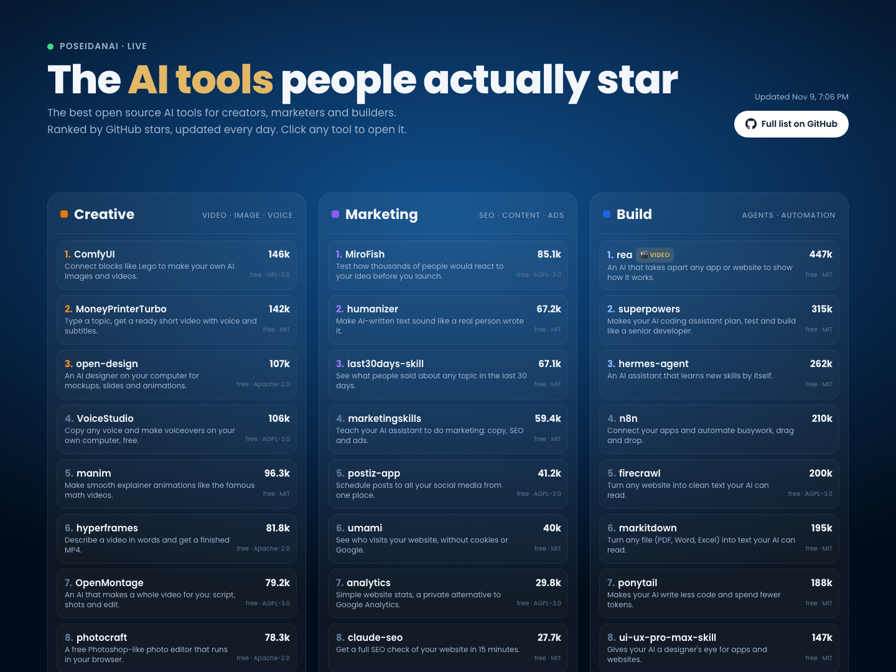

# Awesome AI Tools

[](https://awesome.re) [](LICENSE)

Open source AI tools that do one real job well, picked for creators, marketers and builders by [PoseidanAI](https://github.com/poseidanai).

Every tool here is free to use, has a real license and is alive (pushed in the last months).

**[See the live ranking at poseidanai.com/github-trends →](https://poseidanai.com/github-trends/)** Tools move up and down every day as people star them. Hover any tool there to see it in action.

[](https://poseidanai.com/github-trends/)

🎬 = we made a video about it.

## Contents

- [🎨 Creative](#-creative)
- [📈 Marketing](#-marketing)
- [🛠️ Build](#-build)
- [Built with PoseidanAI](#built-with-poseidanai)
- [Contributing](#contributing)

## 🎨 Creative

Make and edit video, images, voice, music and 3D.

- [photocraft](https://github.com/storytold/photocraft)  - A free Photoshop-like photo editor that runs in your browser. `#photoedit` `#design` `#browser`
- [hyperframes](https://github.com/heygen-com/hyperframes)  - Describe a video in words and get a finished MP4. `#videogen` `#text2video` `#motion`
- [VoiceStudio](https://github.com/debpalash/VoiceStudio)  - Copy any voice and make voiceovers on your own computer, free. `#voiceclone` `#tts` `#local`
- [MoneyPrinterTurbo](https://github.com/harry0703/MoneyPrinterTurbo)  - Type a topic, get a ready short video with voice and subtitles. `#shortvideo` `#videogen` `#autopilot`
- [open-design](https://github.com/nexu-io/open-design)  - An AI designer on your computer for mockups, slides and animations. `#design` `#slides` `#mockups`
- [ComfyUI](https://github.com/Comfy-Org/ComfyUI)  - Connect blocks like Lego to make your own AI images and videos. `#imagegen` `#videogen` `#workflows`
- [filmcraft](https://github.com/storytold/filmcraft)  - A free video editor for cutting, color and sound. `#videoedit` `#color` `#audio`
- [artcraft](https://github.com/storytold/artcraft)  🎬 - A free studio to create and edit AI art and scenes. `#imagegen` `#art` `#scenes`
- [mcp-for-blender](https://github.com/ahujasid/mcp-for-blender)  - Build 3D scenes in Blender just by telling Claude what you want. `#3d` `#blender` `#mcp`
- [OpenMontage](https://github.com/OpenMontageInc/OpenMontage)  - An AI that makes a whole video for you: script, shots and edit. `#videogen` `#script` `#autopilot`
- [autoclip](https://github.com/zhouxiaoka/autoclip)  - Paste a long video, get short viral clips with captions. `#shortvideo` `#clips` `#captions`
- [VideoLingo](https://github.com/Huanshere/VideoLingo)  - Add translated subtitles and dubbing to any video. `#subtitles` `#dubbing` `#translate`
- [YuE](https://github.com/multimodal-art-projection/YuE)  - Make full songs with vocals from your lyrics. `#music` `#songs` `#vocals`
- [Concat](https://github.com/jub0t/Concat)  - A free, simple video editor for Mac, Windows and Linux. `#videoedit` `#desktop` `#free`
- [brag](https://github.com/latent-spaces/brag)  - Make a launch video for your project with one command. `#launchvideo` `#promo` `#cli`
- [TRELLIS](https://github.com/microsoft/TRELLIS)  - Turn a picture into a 3D model. `#3d` `#image2model` `#research`
- [Wan2.2](https://github.com/Wan-Video/Wan2.2)  - A free AI model that makes videos from text or a picture. `#videogen` `#text2video` `#openmodel`
- [GPT-SoVITS](https://github.com/RVC-Boss/GPT-SoVITS)  - Copy a voice from one minute of audio and make it say anything. `#voiceclone` `#tts` `#openmodel`
- [VoxCPM](https://github.com/OpenBMB/VoxCPM)  - Turn text into a natural voice in many languages. `#tts` `#voice` `#multilingual`
- [InvokeAI](https://github.com/invoke-ai/InvokeAI)  - A free studio to make and edit AI images on your computer. `#imagegen` `#studio` `#local`
- [Toonflow-app](https://github.com/HBAI-Ltd/Toonflow-app)  - Turn a story into a full animated video with characters and scenes. `#animation` `#story` `#videogen`
- [rembg](https://github.com/danielgatis/rembg)  - Remove the background from any photo automatically. `#removebg` `#photo` `#image`
- [ebook2audiobook](https://github.com/DrewThomasson/ebook2audiobook)  - Turn any ebook into an audiobook. `#audiobook` `#tts` `#ebooks`
- [pyvideotrans](https://github.com/jianchang512/pyvideotrans)  - Translate a video into another language with a new voice and subtitles. `#translate` `#dubbing` `#subtitles`
- [diffusers](https://github.com/huggingface/diffusers)  - The engine many AI image and video apps are built on. `#imagegen` `#videogen` `#library`
- [manim](https://github.com/3b1b/manim)  - Make smooth explainer animations like the famous math videos. `#animation` `#explainer` `#python`
- [lossless-cut](https://github.com/mifi/lossless-cut)  - Cut and join videos in seconds without losing quality. `#videoedit` `#cut` `#lossless`
- [openscreen](https://github.com/getopenscreen/openscreen)  - Record your screen and make clean demo videos, no watermark. `#screenrec` `#demo` `#video`
- [Graphite](https://github.com/GraphiteEditor/Graphite)  - A free design app for graphics, logos and simple animations. `#design` `#vector` `#logos`
- [moviepy](https://github.com/Zulko/moviepy)  - Edit videos automatically with a few lines of code. `#videoedit` `#python` `#automation`

## 📈 Marketing

SEO, content, ads, outreach and social posting.

- [last30days-skill](https://github.com/mvanhorn/last30days-skill)  - See what people said about any topic in the last 30 days. `#research` `#trends` `#social`
- [humanizer](https://github.com/blader/humanizer)  - Make AI-written text sound like a real person wrote it. `#writing` `#humanize` `#copy`
- [marketingskills](https://github.com/coreyhaines31/marketingskills)  - Teach your AI assistant to do marketing: copy, SEO and ads. `#skills` `#seo` `#copywriting`
- [open-seo](https://github.com/every-app/open-seo)  - A free alternative to Semrush and Ahrefs for SEO research. `#seo` `#keywords` `#free`
- [claude-seo](https://github.com/AgriciDaniel/claude-seo)  - Get a full SEO check of your website in 15 minutes. `#seo` `#audit` `#claude`
- [postiz-app](https://github.com/gitroomhq/postiz-app)  - Schedule posts to all your social media from one place. `#socialmedia` `#scheduler` `#selfhost`
- [MiroFish](https://github.com/666ghj/MiroFish)  - Test how thousands of people would react to your idea before you launch. `#simulation` `#research` `#launch`
- [sellbird](https://github.com/ethanplusai/sellbird)  - An AI that finds clients and writes your sales emails. `#sales` `#leads` `#email`
- [geo-seo-claude](https://github.com/zubair-trabzada/geo-seo-claude)  - Help your website show up in ChatGPT and Perplexity answers. `#geo` `#aisearch` `#seo`
- [claude-ads](https://github.com/AgriciDaniel/claude-ads)  - Your AI checks your ads on 12 platforms and tells you what to fix. `#ads` `#audit` `#claude`
- [youtube-automation-agent](https://github.com/darkzOGx/youtube-automation-agent)  - An AI that runs your YouTube channel, you just approve. `#youtube` `#agent` `#autopilot`
- [MultiPost-Extension](https://github.com/leaperone/MultiPost-Extension)  - Post once and share it to many social networks in one click. `#socialmedia` `#crosspost` `#extension`
- [OpenOutreach](https://github.com/eracle/OpenOutreach)  - Find business clients for your product and reach out to them. `#leads` `#outreach` `#linkedin`
- [claude-blog](https://github.com/AgriciDaniel/claude-blog)  - Write blog posts with real sources that rank on Google. `#blog` `#seo` `#writing`
- [brightbean-studio](https://github.com/brightbeanxyz/brightbean-studio)  - Manage all your social media accounts in one place. `#socialmedia` `#scheduler` `#selfhost`
- [aaron-marketing-skills](https://github.com/aaron-he-zhu/aaron-marketing-skills)  - 120 marketing skills for your AI assistant. `#skills` `#marketing` `#claude`
- [notfair-plugin](https://github.com/nowork-studio/notfair-plugin)  - Ready-made SEO and marketing skills for your AI assistant. `#skills` `#seo` `#marketing`
- [GEOFlow](https://github.com/yaojingang/GEOFlow)  - Write content that AI search engines love, and publish it. `#geo` `#content` `#aisearch`
- [mcp-gsc](https://github.com/AminForou/mcp-gsc)  - Ask Claude questions about your Google search traffic. `#seo` `#searchconsole` `#mcp`
- [opc-skills](https://github.com/ReScienceLab/opc-skills)  - AI skills that help solo founders grow their business. `#skills` `#founders` `#growth`
- [newsjack](https://github.com/elvisun/newsjack)  - An AI PR team that pitches your story to the news. `#pr` `#news` `#outreach`
- [wondelai-skills](https://github.com/wondelai/skills)  - Lessons from famous business books, turned into AI skills. `#skills` `#business` `#books`
- [openserp](https://github.com/karust/openserp)  - Get Google and Bing results for your own tools, free. `#serp` `#search` `#api`
- [postbot](https://github.com/gitcoffee-os/postbot)  - Publish one article or video to many platforms at once. `#crosspost` `#publishing` `#video`
- [pymc-marketing](https://github.com/pymc-labs/pymc-marketing)  - Find out which ads and channels really bring you sales. `#ads` `#attribution` `#analytics`
- [umami](https://github.com/umami-software/umami)  - See who visits your website, without cookies or Google. `#analytics` `#privacy` `#selfhost`
- [analytics](https://github.com/plausible/analytics)  - Simple website stats, a private alternative to Google Analytics. `#analytics` `#privacy` `#selfhost`
- [listmonk](https://github.com/knadh/listmonk)  - Send newsletters to your list from your own server. `#newsletter` `#email` `#selfhost`
- [rybbit](https://github.com/rybbit-io/rybbit)  - Easy, private website analytics. `#analytics` `#privacy` `#selfhost`
- [matomo](https://github.com/matomo-org/matomo)  - Full website analytics where you own all the data. `#analytics` `#selfhost` `#data`

## 🛠️ Build

Agents, automations, docs and dev tools that do real work.

- [caveman](https://github.com/JuliusBrussee/caveman)  - Makes your AI talk shorter, so it costs about a third less. `#tokens` `#cost` `#claude`
- [markitdown](https://github.com/microsoft/markitdown)  - Turn any file (PDF, Word, Excel) into text your AI can read. `#docs2text` `#pdf` `#rag`
- [graphify](https://github.com/Graphify-Labs/graphify)  🎬 - Turn a whole project into a map your AI can understand. `#codemap` `#context` `#agents`
- [Stirling-PDF](https://github.com/Stirling-Tools/Stirling-PDF)  - Edit, sign, merge and convert PDFs for free. `#pdf` `#editor` `#selfhost`
- [hermes-agent](https://github.com/NousResearch/hermes-agent)  - An AI assistant that learns new skills by itself. `#agent` `#selflearning` `#openmodel`
- [ppt-master](https://github.com/hugohe3/ppt-master)  - Turn any document into a real, editable PowerPoint. `#slides` `#pptx` `#docs`
- [ponytail](https://github.com/DietrichGebert/ponytail)  - Makes your AI write less code and spend fewer tokens. `#tokens` `#coding` `#cost`
- [claude-mem](https://github.com/thedotmack/claude-mem)  - Your AI remembers what you worked on yesterday. `#memory` `#claude` `#coding`
- [superpowers](https://github.com/obra/superpowers)  - Makes your AI coding assistant plan, test and build like a senior developer. `#coding` `#workflow` `#skills`
- [n8n](https://github.com/n8n-io/n8n)  - Connect your apps and automate busywork, drag and drop. `#automation` `#workflows` `#nocode`
- [career-ops](https://github.com/career-ops-hq/career-ops)  🎬 - An AI that finds jobs, tailors your resume and preps you. `#jobs` `#resume` `#agent`
- [browser-use](https://github.com/browser-use/browser-use)  - An AI that clicks around websites and does tasks for you. `#browser` `#agent` `#automation`
- [paperclip](https://github.com/paperclipai/paperclip)  - Run a team of AI agents like a small company. `#agents` `#team` `#orchestration`
- [archify](https://github.com/tt-a1i/archify)  - Turn an idea into a clear, clickable diagram. `#diagrams` `#ideas` `#visual`
- [taste-skill](https://github.com/Leonxlnx/taste-skill)  - Gives your AI a designer's taste, so the pages it builds stop looking generic. `#webdesign` `#frontend` `#skills`
- [ui-ux-pro-max-skill](https://github.com/nextlevelbuilder/ui-ux-pro-max-skill)  - Gives your AI a designer's eye for apps and websites. `#webdesign` `#uiux` `#skills`
- [Understand-Anything](https://github.com/Egonex-AI/Understand-Anything)  - Explore any code as a simple visual map. `#codemap` `#visual` `#learning`
- [Agent-Reach](https://github.com/Panniantong/Agent-Reach)  - Lets your AI read Twitter, Reddit and YouTube. `#agent` `#social` `#research`
- [rtk](https://github.com/rtk-ai/rtk)  - Makes your AI assistant much cheaper to run. `#tokens` `#cost` `#cli`
- [headroom](https://github.com/headroomlabs-ai/headroom)  🎬 - Cuts what you send to AI, so you pay less for the same answers. `#tokens` `#cost` `#proxy`
- [OmniRoute](https://github.com/cheaper-inference/OmniRoute)  - Use hundreds of AI models from one place, many for free. `#llmrouter` `#models` `#free`
- [impeccable](https://github.com/pbakaus/impeccable)  - Stops your AI from making websites that look AI-made. `#webdesign` `#frontend` `#skills`
- [CLI-Anything](https://github.com/HKUDS/CLI-Anything)  🎬 - Lets your AI use any app on your computer. `#agent` `#desktop` `#cli`
- [rea](https://github.com/morluto/rea)  🎬 - An AI that takes apart any app or website to show how it works. `#reverse` `#research` `#agent`
- [orca](https://github.com/stablyai/orca)  🎬 - Run many AI coding assistants at once, even from your phone. `#coding` `#agents` `#mobile`
- [t3code](https://github.com/pingdotgg/t3code)  - Control your AI coding assistants from your phone. `#coding` `#agents` `#mobile`
- [coolify](https://github.com/coollabsio/coolify)  - Host your own websites and apps on your own server. `#hosting` `#selfhost` `#webdev`
- [emilkowalski-skills](https://github.com/emilkowalski/skills)  - Teaches your AI the rules smooth, polished animations follow. `#animation` `#frontend` `#skills`
- [firecrawl](https://github.com/firecrawl/firecrawl)  - Turn any website into clean text your AI can read. `#scraping` `#web2text` `#rag`
- [timesfm](https://github.com/google-research/timesfm)  🎬 - Google's AI that predicts what happens next in your numbers. `#forecasting` `#data` `#google`

## Built with PoseidanAI

Projects people built on our open source tools. Built something? Add the badge to your README and open a PR to get listed here.

```markdown
[](https://github.com/poseidanai)
```

_Be the first one._

## Contributing

Know a tool that belongs here? Read [CONTRIBUTING.md](CONTRIBUTING.md) and open a PR. One tool per PR, one line, no affiliate links. Live ranking: [poseidanai.com/github-trends](https://poseidanai.com/github-trends/)
